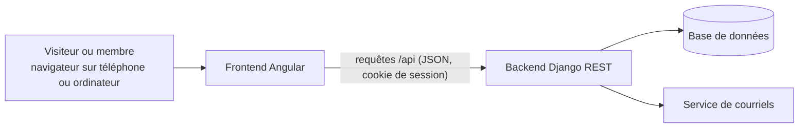
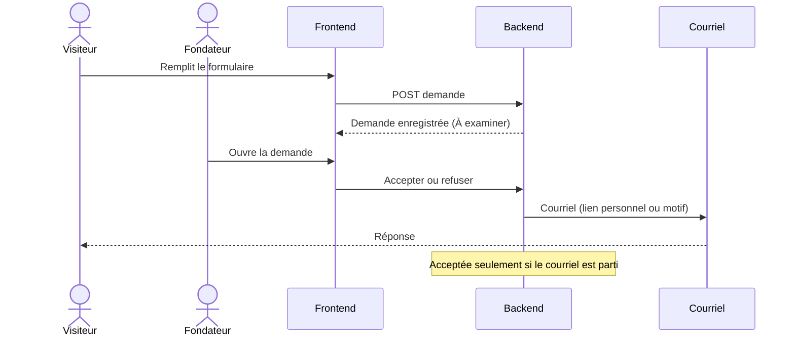

# Architecture technique

Vue d'ensemble de la plateforme. Document vivant, mis à jour avec le code.

## Vue d'ensemble



## Composants

| Composant | Dossier | Rôle |
|---|---|---|
| Frontend | `frontend/` | Application Angular : pages publiques, interface membre, interface bureau exécutif |
| Backend | `backend/` | API Django REST : comptes, territoires, demandes, membres, programmes |
| Base de données | SQLite en local, à choisir en production | Stockage des données |
| Courriels | Service d'envoi configurable | Réponses aux demandes, liens personnels, réinitialisation de mot de passe |

## Backend

- **Django 6** et **Django REST Framework**.
- Compte unique `accounts.User` : connexion par courriel, rôle `membre`, `coordonnateur` ou `fondateur`. Le bureau exécutif réunit coordonnateurs et fondateurs.
- Droits : vérifiés par le serveur à chaque requête, selon le rôle et le territoire.
- Configuration sensible lue dans l'environnement. En local, `backend/.env` (copie de `backend/.env.example`, jamais versionnée) est chargé au démarrage ; une variable déjà définie dans l'environnement est prioritaire.

### Applications Django

```
backend/
  config/        réglages, routes, lecture du fichier .env
  core/          socle commun : point de contrôle /api/health/, courriels, chiffrement, historiques non modifiables
  accounts/      comptes et rôles
  territories/   territoires emboîtés pays, région, commune
  applications/  demandes d'adhésion et leur examen
  members/       membres, numéros, statuts, cartes
  audit/         journal des actions, non modifiable
  dashboard/     chiffres du tableau de bord du bureau
  programs/      programmes, activités, comptes rendus, présences, inscriptions
```

Chaque application regroupe ses modèles, son administration, ses routes (`urls.py`), ses vues et ses tests (`tests.py`).

### Territoires

Modèle `territories.Territory` : nom, type (`pays`, `region`, `commune`), territoire parent, actif ou non.

- Une commune est rattachée à une région, une région à un pays, un pays à rien. Vérifié à chaque enregistrement et par une contrainte en base.
- Un nom est unique parmi les territoires d'un même parent (une commune peut porter le nom de sa région).
- Un territoire utilisé ne peut pas être supprimé (protection en base) : on le désactive.
- Chaque compte peut être rattaché à un territoire (`User.territory`) : territoire du membre, ou territoire de coordination du coordonnateur (obligatoire pour lui). Un fondateur n'en a pas besoin.
- Règle d'accès réutilisable (`territories/scope.py`) : un fondateur voit tout ; un coordonnateur voit son territoire et tous ceux qui en dépendent ; un membre simple ne voit rien au bureau. Toute liste du bureau passe par `scope_queryset(...)`. Un objet hors du périmètre répond 404, pas 403, pour ne pas révéler son existence.
- Territoires de départ chargés par la migration `0002` : le Sénégal, ses 14 régions et 47 communes (chefs-lieux des 46 départements, plus Touba), à compléter par les fondateurs depuis l'administration.

### Demandes d'adhésion

Modèle `applications.Application` : référence, prénom, nom, courriel, localité souhaitée (territoire), profession, motivation, date du consentement, statut, dates de dépôt et de modification.

- Statuts : `a_examiner` (À examiner), `acceptee` (Acceptée), `rejetee` (Rejetée), `inscrite` (Inscrite). Une demande est « en cours » tant qu'elle est à examiner ou acceptée.
- Un même courriel (sans tenir compte des majuscules) ne peut avoir qu'une demande en cours : vérifié par l'API et par une contrainte en base. Un courriel déjà utilisé par un compte est refusé.
- Référence `TAB-AAAA-NNNNN` : année de dépôt et numéro unique de la demande (exemple : `TAB-2026-00418`). Le numéro ne repart pas de zéro chaque année.
- La localité est un territoire actif (commune ou région) dont les parents sont actifs.
- Le consentement au traitement des données est obligatoire ; sa date est conservée.
- Dépôt public limité à 10 envois par heure depuis une même adresse (variable `ADHESION_RATE`).
- Dans l'administration Django, les demandes sont en lecture seule : les décisions passent par l'API d'examen, qui envoie les courriels.
- Examen réservé aux fondateurs (`accounts.permissions.IsFounder`). Seule une demande « À examiner » peut être acceptée ou refusée ; chaque décision enregistre son auteur, sa date et une note interne facultative.
- Un refus exige un motif écrit, envoyé par courriel à la personne. Toute décision n'est enregistrée que si son courriel est parti : sinon la demande reste « À examiner » et le fondateur voit l'erreur (`503 email_not_sent`). Logique dans `applications/services.py`.
- L'acceptation crée un lien personnel (`RegistrationLink`) et l'envoie par courriel : `FRONTEND_URL/finaliser?jeton=…`. Le jeton (256 bits aléatoires) n'est jamais conservé, seule son empreinte SHA-256 l'est (`core/tokens.py`). Le lien est valable 7 jours et ne sert qu'une fois (consommation atomique). Si le courriel ne part pas, le lien n'existe pas et la demande reste « À examiner ».
- Écran du bureau (`/bureau/demandes`, `/bureau/demandes/:id`, fondateurs seulement) : `core/review.service.ts` appelle `GET /api/applications/` (filtre `status`, recherche `search`, pagination), `GET /api/applications/:id/`, `POST …/accept/`, `POST …/reject/` (motif obligatoire, contrôlé aussi côté serveur) et `POST …/resend-link/` (bouton « Renvoyer le lien d'inscription » sur une demande acceptée, avec la date de fin de validité du dernier lien). L'erreur `email_not_sent` est affichée telle quelle ; la demande reste « À examiner ». Aucune donnée fictive.

### Membres

Modèle `members.Member`, relié à un compte (un dossier par compte) : numéro de membre, date d'adhésion.

- Numéro `TBX-AAAA-NNNNN` attribué automatiquement à la création : année d'adhésion et numéro d'ordre unique, jamais réutilisé (exemple : `TBX-2026-00125`). Unicité garantie en base.
- Adresse et téléphone (facultatif) chiffrés en base ; photo, date d'acceptation des statuts et du règlement, demande d'origine.
- Finalisation (`members/registration.py`) : le lien personnel reçu à l'acceptation permet de choisir son mot de passe (règles de sécurité de Django : 10 caractères au moins, pas seulement des chiffres, pas un mot de passe courant, pas semblable au nom ou au courriel), de donner son adresse et sa photo. Le compte membre (actif, rattaché au territoire de la demande) et son dossier sont créés, le lien est consommé et la demande passe « Inscrite », en une seule transaction ; la session s'ouvre. Lien inconnu : 404 `invalid_link` ; expiré : 410 `link_expired` ; déjà utilisé : 410 `link_used`, chacun avec un message qui dit quoi faire.
- Statut : `actif` (Actif), `suspendu` (Suspendu) ou `radie` (Radié), `actif` par défaut. Un seul point d'entrée le change, `members/status.py` (`change_status`), en une transaction : suspendu ou radié désactive le compte (plus de connexion) et ferme ses sessions ouvertes (`accounts/sessions.py`), actif le réactive, et chaque changement ajoute une ligne à l'historique `members.MemberStatusChange` (ancien et nouveau statut, motif, auteur, date). Rien n'est supprimé : le dossier, le numéro et les données restent, un dossier ne se supprime pas (même dans l'administration, où le statut est en lecture seule et l'accès `is_active` d'un membre aussi).
- Historique non modifiable : `MemberStatusChange` repose sur `core/append_only.py` (ni `save` sur une ligne existante, ni `delete`, ni `update`/`delete` en lot : `ImmutableRecordError`). Seuls les fondateurs voient l'historique.
- Règles du changement de statut (`members.status.can_change_status`) : un fondateur pour les membres simples et les coordonnateurs, un coordonnateur pour les membres simples de sa zone (pas les autres membres du bureau). Le compte d'un membre fondateur ne se suspend ni ne se radie depuis la plateforme, même par un autre fondateur (403) : seul le développeur le fait, avec `python manage.py statut_compte <courriel> <statut> --motif "…"` (voir `docs/DEPLOIEMENT.md`), noté « Système » au journal ; un motif est obligatoire pour suspendre ou radier ; on ne change pas son propre statut ; changer vers le statut actuel est refusé (409). Les coordonnateurs et fondateurs invités ont aussi un dossier de membre, créé à l'acceptation de l'invitation.
- Bases du bureau : `GET /api/members/` (membres simples, ou coordonnateurs et fondateurs avec `role=coordonnateur,fondateur`) et la fiche `GET /api/members/<id>/` sont limitées au territoire de la personne connectée (`territories/scope.py`) ; hors périmètre, la fiche répond 404 et une liste filtrée sur un autre territoire reste vide. Un fondateur n'étant rattaché à aucun territoire, seuls les fondateurs le voient dans la base du bureau.
- Dossier du bureau : chaque compte du bureau a un dossier de membre (numéro, date d'entrée, statut, carte) : à l'acceptation de l'invitation, à la création d'un fondateur par `createsuperuser`, ou depuis l'administration pour un compte créé avec un mot de passe ; la migration `members/0004` ouvre celui des comptes du bureau existants.
- Photos : vérifiées (vraie image JPG ou PNG, 5 Mo au plus), réenregistrées en JPEG de 800 pixels au plus, sans aucune métadonnée (position GPS comprise), sous un nom aléatoire dans `MEDIA_ROOT/photos/`. Jamais servies directement : seulement par l'API, à la personne concernée.

### Journal des actions

Modèle `audit.AuditEntry` : action, auteur (avec son nom du moment, la ligne reste lisible si le compte change), personne ou liste concernée, détails, date.

- Actions enregistrées automatiquement : acceptation et refus d'une demande (avec le motif), changement de statut d'un membre (avec l'ancien et le nouveau statut et le motif), invitation au bureau, export d'une liste. `audit.services.record` est appelé dans la transaction de l'action : un courriel qui ne part pas annule la décision et sa ligne de journal, et une action refusée n'écrit rien.
- Non modifiable : `AuditEntry` repose sur `core/append_only.py` (ni `save` sur une ligne existante, ni `delete`, ni `update`/`delete`/`bulk_update` en lot : `ImmutableRecordError`), aucune route n'écrit dans le journal (`GET` seulement, les autres méthodes répondent 405) et l'administration Django le montre en lecture seule, sans ajout, modification ni suppression. Un compte qui a agi ne peut pas être supprimé.
- Les détails (motifs, courriels, filtres d'export) sont chiffrés en base (`core.fields.EncryptedJSONField`) comme les motifs de refus des demandes ; `manage.py rechiffrer` change la clé du journal sans en modifier le contenu (`AppendOnlyQuerySet.reencrypt`).
- Consultation réservée aux fondateurs : `GET /api/audit/`, du plus récent au plus ancien, filtres `action`, `actor`, `search`, `date_from`, `date_to`.

### Programmes et activités

Application `programs` : `Program` (nom, objectif, localité, responsable, début, fin, état `prevu` Prévu, `en_cours` En cours, `termine` Terminé ou `annule` Annulé), `Activity` (programme, titre, début, fin facultative, lieu, description, puis compte rendu et liste des présences), `Registration` (inscription d'un membre) et `Attendance` (présence d'un membre). Rien ne se supprime : un programme se termine ou s'annule, et la localité d'un programme ne peut pas être supprimée (`PROTECT`, comme les membres).

- Droits du bureau (`programs/rules.py`) : un coordonnateur crée, modifie et consulte les programmes de son territoire et de ceux qui en dépendent, un fondateur tous (`territories/scope.py`) ; hors périmètre, un programme ou une activité répond 404, et on ne peut ni en créer ni y déplacer un programme (400 « hors de votre périmètre »). Les membres simples n'ont aucun accès à ces routes (403).
- Règles de cohérence : la fin d'un programme ne précède pas son début ; le responsable est un fondateur ou un coordonnateur actif qui gère la localité (`GET /api/programs/managers/`) ; une activité se déroule pendant son programme (date, et fin au plus tard à la fin du programme) ; on ne resserre pas les dates d'un programme autour d'activités qui sortiraient de la période ; un programme annulé n'accepte plus d'activité. Les activités s'affichent par ordre de date sous leur programme.
- Compte rendu (`PUT /api/activities/<id>/report/`) : écrit après le début de l'activité (409 `not_started` avant), attaché à l'activité avec son auteur et sa date, visible du bureau du territoire, corrigeable ; il peut mettre à jour l'état du programme (`program_status`). Les membres ne le lisent pas.
- Présences (`GET` puis `PUT /api/activities/<id>/attendance/`) : la liste à cocher réunit les inscrits et les membres actifs de la localité du programme (et de celles qui en dépendent) ; l'enregistrement remplace la liste, accepte une liste vide (« notée, aucun présent ») et refuse un membre hors de cette liste ; le nombre de présents s'affiche sur l'activité (`null` tant que la liste n'est pas notée). Comme le compte rendu, elle se note une fois l'activité commencée.
- Membres (`/api/member/…`) : un membre voit les programmes de son territoire et de ceux dont il dépend (le programme d'une région concerne les membres de ses communes), jamais ceux des autres territoires, ni les programmes annulés ; par défaut les programmes prévus et en cours, avec `status=termine` les terminés. Il s'inscrit et se désinscrit lui-même (`POST` et `DELETE …/registration/`, sans doublon) tant que le programme est prévu ou en cours et que l'activité n'a pas commencé (409 `registration_closed` ensuite) ; une activité d'un autre territoire répond 404. Le bureau voit la liste des inscrits (`GET /api/activities/<id>/registrations/`) et peut l'exporter.

### Tableau de bord

`GET /api/dashboard/` (bureau exécutif, `dashboard/services.py`) renvoie les chiffres du périmètre de la personne connectée : un fondateur voit tout le mouvement, un coordonnateur son territoire et ceux qui en dépendent (`territories/scope.py`).

- Chiffres : `active_members` (membres simples actifs) et `joined_this_month`, `coordinators` (coordonnateurs et fondateurs actifs), `pending_applications` (demandes à examiner dont la localité est dans le périmètre), `programs_in_progress` (programmes en cours du périmètre, comme `GET /api/programs/?status=en_cours`), `upcoming_programs` (les quatre prochains programmes prévus ou en cours, pas encore finis), `territories` (membres et coordonnateurs actifs de chaque territoire, les plus nombreux d'abord), `monthly_joined` (nouveaux membres de chacun des douze derniers mois, zéro compris).
- Les chiffres se calculent sur les mêmes listes que les écrans (`members.filters.scoped_members`) : le total de membres actifs est celui de `GET /api/members/?status=actif`, celui des coordonnateurs celui de `GET /api/members/?status=actif&role=coordonnateur,fondateur`, et la somme de `territories` est `active_members`. Un membre suspendu ou radié n'est pas compté comme actif.
- `recent_applications` (demandes à examiner les plus récentes) et `recent_actions` (dernières lignes du journal) ne sont envoyés qu'aux fondateurs ; ils valent `null` pour un coordonnateur.

### Exports Excel

Chaque liste du bureau a son export `.xlsx` : `GET /api/members/export/` (base des membres et, avec `role=coordonnateur,fondateur`, base des coordonnateurs), `GET /api/applications/export/` (demandes, fondateurs) et `GET /api/audit/export/` (journal, fondateurs).

- Le fichier contient exactement la liste filtrée : l'export prend les mêmes paramètres que la liste (`members/filters.py`, `applications/filters.py`, `audit/filters.py`), le même périmètre de territoire et le même ordre, sans les pages. Un filtre invalide répond 400 : ni fichier ni ligne de journal.
- Chaque export est noté dans le journal des actions (action « Liste exportée » : auteur, liste, nombre de lignes, filtres en clair, nom du fichier), dans la même transaction que la fabrication du fichier (`audit/exports.py`).
- Colonnes limitées à ce que la liste montre, plus le courriel : l'adresse et le téléphone des membres, la motivation et les notes des demandes ne sont jamais exportés.
- Sécurité du fichier (`core/xlsx.py`) : tout texte est écrit comme du texte, jamais comme une formule, donc un nom saisi sous la forme `=HYPERLINK(…)` s'ouvre tel quel dans Excel ; réponse `Cache-Control: no-store`.

### Courriels

- Service unique `core.mail.send_email(to=…, subject=…, body=…)` : il lève `EmailNotSent` si le courriel ne part pas (serveur injoignable, refus, envoi non confirmé). L'échec est écrit dans le journal du serveur, sans l'adresse du destinataire.
- Configuration par variables d'environnement (`backend/.env.example`) : sans `EMAIL_HOST`, les courriels s'affichent dans la console du serveur ; avec `EMAIL_HOST`, ils partent par SMTP (`EMAIL_PORT`, `EMAIL_HOST_USER`, `EMAIL_HOST_PASSWORD`, `EMAIL_USE_TLS` ou `EMAIL_USE_SSL`, `EMAIL_TIMEOUT`). Expéditeur : `DEFAULT_FROM_EMAIL`.
- Aucun identifiant dans le code : ils ne vivent que dans l'environnement ou dans `backend/.env`, ignoré par Git.

### Conventions de l'API

- Toutes les routes commencent par `/api/` et se terminent par une barre oblique (`/api/health/`).
- Échanges en JSON uniquement. L'interface navigable de Django REST Framework n'est active qu'en développement (`DJANGO_DEBUG=1`).
- Par défaut, une route exige une connexion ; les routes publiques le déclarent explicitement.
- Messages d'erreur en français. Une erreur générale a toujours la forme `{"detail": "…", "code": "…"}` (`not_authenticated`, `permission_denied`, `not_found`, `session_expired`…, voir `core/exceptions.py`) ; une erreur de saisie liste les messages par champ (`{"email": ["Ce champ est obligatoire."]}`).
- `401` : personne n'est connecté (le frontend renvoie vers la connexion). `403` : la personne connectée n'a pas le droit.
- Identifiants dans les adresses : un membre, une demande, un programme ou une activité se désigne par son identifiant public, un UUID aléatoire (`public_id`, `core.fields.public_id_field`), jamais par sa clé primaire. Le champ `id` des réponses est cet identifiant, et `<id>` dans les routes ci-dessous aussi : changer un chiffre de l'adresse ne mène à aucune autre fiche (404). Les clés primaires (entiers) ne servent qu'en interne. Les territoires, publics, gardent leur numéro.

### Connexion et sécurité des requêtes

- Session Django par cookie, sur le même domaine que le frontend (le proxy Angular renvoie `/api` vers Django en développement).
- Courriel reconnu sans tenir compte des majuscules ; un courriel ne sert qu'à un seul compte (contrainte en base).
- Un compte désactivé (suspendu ou radié) ne peut plus se connecter (`403 inactive_account`, avec un message propre à la suspension ou à la radiation, donné seulement à la personne qui connaît son mot de passe), et sa session en cours cesse aussitôt d'être valable.
- Sans « rester connecté », la session se ferme avec le navigateur.
- La session d'un coordonnateur ou d'un fondateur se ferme après 30 minutes sans requête (`accounts.middleware.BureauInactivityMiddleware`, réglable par `BUREAU_INACTIVITY_MINUTES`) ; la requête suivante reçoit `401 session_expired`. Les membres simples ne sont pas concernés.
- Blocage temporaire (`accounts/lockout.py`) : après 5 échecs pour un même courriel, ou 20 depuis une même adresse IP, la connexion est refusée pendant 15 minutes (`429 too_many_attempts`, en-tête `Retry-After`), même avec le bon mot de passe. Une connexion réussie efface les échecs du compte ; les échecs sont effacés après un jour. Derrière un proxy en production, régler `LOGIN_TRUSTED_PROXIES` pour lire la vraie adresse du visiteur.
- Mot de passe oublié (`accounts/password_reset.py`) : lien par courriel vers `FRONTEND_URL/nouveau-mot-de-passe?jeton=…`, valable **une heure**, utilisable une fois ; un nouveau lien annule le précédent ; trois demandes par heure au plus par compte. La réponse est la même qu'un compte existe ou non. Le nouveau mot de passe ferme les autres sessions et lève le blocage de connexion.
- Invitation au bureau (`accounts/invitations.py`) : un fondateur saisit courriel, nom, fonction (coordonnateur ou fondateur) et territoire (obligatoire pour un coordonnateur). Le compte est créé sans mot de passe utilisable et un lien (7 jours, une fois) part vers `FRONTEND_URL/invitation?jeton=…` ; si le courriel ne part pas, rien n'est créé. En acceptant, la personne choisit son mot de passe, reçoit son dossier et son numéro, et sa session s'ouvre sur l'interface du bureau.
- Liens personnels (inscription, réinitialisation, invitation) : le jeton n'est jamais conservé, seule son empreinte l'est (`core/tokens.py`) ; un lien est valable un temps limité et ne sert qu'une fois.
- Protection CSRF aux noms attendus par Angular : Django dépose le cookie `XSRF-TOKEN` (à la connexion et sur `GET /api/auth/me/`), et chaque requête qui modifie renvoie sa valeur dans l'en-tête `X-XSRF-TOKEN`. Le client HTTP d'Angular le fait tout seul.

### Routes

| Méthode et route | Accès | Rôle |
|---|---|---|
| `GET /api/health/` | public | Contrôle de santé : `{"status": "ready"}` (200), ou `{"status": "unavailable"}` (503) si la base est injoignable |
| `POST /api/auth/login/` | public | Connexion. Corps : `email`, `password`, `remember` (facultatif). Renvoie l'utilisateur (200) ; 400 `invalid_credentials` ; 403 `inactive_account` ; 429 `too_many_attempts` |
| `POST /api/auth/logout/` | public | Déconnexion (204) |
| `GET /api/auth/me/` | connecté | Utilisateur connecté : `id`, `email`, `first_name`, `last_name`, `role`, `role_label`, `is_bureau`, `territory` ; 401 sinon |
| `POST /api/auth/password/forgot/` | public | Mot de passe oublié. Corps : `email`. Répond toujours 202 avec le même message, que le compte existe ou non ; envoie un lien valable 1 h (3 demandes par heure et par compte au plus, un nouveau lien annule le précédent ; pas de lien pour un compte suspendu ou radié) ; 429 si trop d'envois |
| `POST /api/auth/password/reset/check/` | public | Vérifie le lien. Corps : `token`. 200 `valid` ; 404 `invalid_link` ; 410 `link_used` ou `link_expired` |
| `POST /api/auth/password/reset/` | public | Nouveau mot de passe. Corps : `token`, `password`, `password_confirm` (règles de sécurité de Django, messages en français) ; le lien est consommé ; mêmes erreurs de lien que `check/` ; 400 avec un message par champ |
| `POST /api/auth/invitations/` | fondateur | Invite une personne au bureau. Corps : `email`, `first_name`, `last_name`, `role` (`coordonnateur` ou `fondateur`), `territory` (obligatoire pour un coordonnateur). Crée le compte sans mot de passe et envoie un lien valable 7 jours ; 201 ; 400 par champ (courriel déjà utilisé, demande d'adhésion en cours) ; 503 `email_not_sent` : aucun compte n'est créé ; 403 hors fondateur |
| `POST /api/auth/invitation/check/` | public | Vérifie le lien d'invitation. Corps : `token`. 200 avec la personne invitée ; 404 `invalid_link` ; 410 `link_used` ou `link_expired` |
| `POST /api/auth/invitation/accept/` | public | La personne invitée choisit son mot de passe (`token`, `password`, `password_confirm`) ; le lien est consommé, la session s'ouvre et l'utilisateur est renvoyé (201) |
| `POST /api/auth/password/change/` | connecté | Changement du mot de passe. Corps : `current_password`, `new_password`, `new_password_confirm`. La session reste ouverte, les autres sont fermées |
| `GET /api/territories/` | public | Territoires actifs en arbre pays > région > commune, par ordre alphabétique : `[{"id", "name", "kind", "kind_label", "children": [...]}]`. Un territoire dont un parent est inactif n'apparaît pas |
| `GET /api/territories/managed/` | bureau | Territoires du périmètre de la personne connectée, actifs ou non, en ordre d'arbre : `id`, `name`, `kind`, `kind_label`, `path`, `parent`, `is_active`, et ce qui y est rattaché directement : `members_count`, `coordinators_count`, `programs_count`, `applications_count`, `children_count`, `deletable` |
| `POST /api/territories/managed/` | fondateur | Ajoute un territoire. Corps : `name`, `kind` (`pays`, `region`, `commune`), `parent` (un pays pour une région, une région pour une commune), `is_active`. 201 avec la ligne ; 400 par champ (hiérarchie, nom déjà pris au même endroit) ; 403 hors fondateur |
| `GET /api/territories/managed/<id>/` | bureau | Un territoire du périmètre ; 404 s'il est hors périmètre |
| `PATCH /api/territories/managed/<id>/` | fondateur | Renomme, rattache ailleurs, active ou désactive ; le type ne change pas si le territoire en contient d'autres ; 400 par champ |
| `DELETE /api/territories/managed/<id>/` | fondateur | Supprime un territoire vide (204) ; 409 avec la raison s'il contient des membres, des coordonnateurs, des programmes, des demandes ou d'autres territoires (« Désactivez-le plutôt. ») |
| `POST /api/applications/` | public | Dépôt d'une demande. Corps : `first_name`, `last_name`, `email`, `territory` (identifiant), `profession`, `motivation`, `consent` (`true`). Renvoie `reference`, `status`, `status_label`, `created_at` (201) ; 400 avec un message par champ ; 429 si trop d'envois |
| `GET /api/applications/` | fondateur | Demandes, les plus récentes d'abord, par pages de 20 (`count`, `next`, `previous`, `results`). Filtres : `status`, `search` (nom, prénom, courriel, référence), `page`, `page_size` |
| `GET /api/applications/<id>/` | fondateur | Demande complète : identité, localité (`territory.path`), motivation, statut, décision (`decided_by`, `decided_at`, `rejection_reason`, `internal_note`) |
| `GET /api/applications/export/` | fondateur | Fichier Excel de la liste des demandes affichée (mêmes filtres `status` et `search`), sans motivation ni notes ; noté dans le journal |
| `POST /api/applications/<id>/accept/` | fondateur | Acceptation. Corps : `internal_note` (facultatif). Envoie le lien personnel d'inscription. 409 `already_decided` ; 503 `email_not_sent` (la demande reste « À examiner ») |
| `POST /api/registration/check/` | public | Vérifie un lien personnel. Corps : `token`. Renvoie `first_name`, `last_name`, `email`, `territory`, `expires_at` ; 404 `invalid_link`, 410 `link_expired` ou `link_used` |
| `POST /api/registration/` | public | Finalise l'inscription (formulaire multipart). Champs : `token`, `address`, `phone` (facultatif), `photo`, `password`, `password_confirm`, `accept_rules`. Renvoie `user` et `member_number` (201) et ouvre la session ; 400 avec un message par champ ; 409 `account_exists` |
| `GET /api/members/me/` | connecté | Profil et données de carte : `number`, `joined_on`, `first_name`, `last_name`, `email`, `role`, `role_label`, `territory`, `address`, `phone`, `photo_url`, `coordinator` (le coordonnateur le plus proche : celui de son territoire, sinon d'un territoire dont il dépend) ; 404 sans dossier de membre |
| `PATCH /api/members/me/` | connecté | Modifie `first_name`, `last_name` (non vides), `address`, `phone`, `photo` (multipart pour la photo ; l'ancienne photo est effacée). Courriel, territoire, numéro et date d'adhésion : 400 « Seul le bureau peut modifier cette information. » |
| `GET /api/members/me/photo/` | connecté | Photo de profil de la personne connectée (JPEG) ; 404 sans photo. `photo_url` y ajoute `?v=…`, propre à chaque photo, pour qu'une nouvelle photo ne soit jamais masquée par l'ancienne en cache |
| `DELETE /api/members/me/photo/` | connecté | Retire la photo de profil et efface le fichier (204, même sans photo) |
| `GET /api/members/` | bureau | Base des membres ou du bureau, limitée au périmètre (territoire du coordonnateur et ceux qui en dépendent ; tout pour un fondateur), par pages de 20. Filtres (`members/filters.py`) : `role` (un ou plusieurs rôles séparés par des virgules : `membre` par défaut, `coordonnateur,fondateur` pour la base des coordonnateurs), `status` (`actif`, `suspendu`, `radie`), `territory` (identifiant : le territoire et tous ceux qui en dépendent), `joined_from` et `joined_to` (date d'adhésion ou d'entrée, `AAAA-MM-JJ`, bornes comprises), `search` (prénom, nom, courriel ou numéro ; plusieurs mots doivent tous correspondre), `ordering` (`name`, `place`, `date`, précédé de `-` pour inverser ; plus récents d'abord par défaut), `page`, `page_size`. Lignes : `id`, `number`, `first_name`, `last_name`, `email`, `role`, `role_label`, `territory`, `joined_on`, `status`, `status_label` ; 400 par champ pour un filtre inconnu (`territory` : « Localité inconnue. », dates : « Saisissez une date valide au format AAAA-MM-JJ. », période à l'envers) ; un territoire hors du périmètre ne donne aucun résultat |
| `GET /api/members/export/` | bureau | Fichier Excel de la liste affichée : mêmes filtres que `GET /api/members/` (sans `page`), même périmètre et même ordre ; colonnes N° d'adhérent, Nom, Prénom, Courriel, Fonction, Localité, Date d'adhésion (ou d'entrée), Statut ; noté dans le journal ; 400 pour un filtre invalide |
| `GET /api/members/<id>/` | bureau | Fiche d'un membre : la ligne ci-dessus plus `phone`, `address`, `photo_url` et, pour les fondateurs seulement, `status_history` ; 404 hors périmètre |
| `GET /api/dashboard/` | bureau | Chiffres du tableau de bord dans le périmètre de la personne connectée : `scope`, `active_members`, `joined_this_month`, `coordinators`, `pending_applications`, `programs_in_progress`, `upcoming_programs`, `territories` (`territory`, `members`, `coordinators`), `monthly_joined` (`month` `AAAA-MM`, `count`), et pour les fondateurs seulement `recent_applications` et `recent_actions` (`null` sinon) |
| `GET /api/programs/` | bureau | Programmes du périmètre, par pages de 20. Filtres : `status` (`prevu`, `en_cours`, `termine`, `annule`), `territory` (la localité et celles qui en dépendent), `search` (nom ou objectif), `ordering` (`name` ou `date`, `-` pour inverser), `page`, `page_size`. Lignes : `id`, `name`, `objective`, `territory`, `manager`, `start_date`, `end_date`, `status`, `status_label`, `activities_count` |
| `POST /api/programs/` | bureau | Crée un programme. Corps : `name`, `objective`, `territory`, `manager` (facultatif), `start_date`, `end_date`, `status` (`prevu` par défaut). 201 avec la fiche ; 400 par champ en français ; localité hors périmètre refusée |
| `GET /api/programs/<id>/` · `PATCH` | bureau | Fiche d'un programme avec ses `activities` par ordre de date (compte rendu, `registrations_count`, `attendance_noted`, `attendance_count`), et modification partielle ; 404 hors périmètre ; pas de suppression (405) |
| `GET /api/programs/managers/?territory=<id>` | bureau | Responsables possibles pour une localité : `id`, `name`, `role_label` |
| `GET /api/programs/export/` | bureau | Fichier Excel de la liste affichée (mêmes filtres), noté dans le journal |
| `POST /api/programs/<id>/activities/` | bureau | Ajoute une activité. Corps : `title`, `starts_at`, `ends_at` (facultatif), `place`, `description`. 201 ; 400 si la date sort de la période du programme ou si le programme est annulé |
| `GET /api/activities/<id>/` · `PATCH` | bureau | Fiche d'une activité et modification ; 404 hors périmètre |
| `PUT /api/activities/<id>/report/` | bureau | Compte rendu. Corps : `report`, `program_status` (facultatif). 409 `not_started` avant l'activité ; 400 par champ |
| `GET /api/activities/<id>/attendance/` · `PUT` | bureau | Liste à cocher (`members` : `id`, `number`, `first_name`, `last_name`, `territory`, `registered`, `present`) et enregistrement des présents (`{"members": [identifiants]}`) ; 409 `not_started` avant l'activité ; 400 pour un membre hors liste |
| `GET /api/activities/<id>/registrations/` | bureau | Inscrits à l'activité (`count`, `results`) ; `…/registrations/export/` en fichier Excel, noté dans le journal |
| `GET /api/member/programs/` | connecté | Programmes du territoire du membre (et de ceux dont il dépend), avec leurs activités par ordre de date (`registered`, `registrations_count`, `registration_open`), par pages de 20 ; `status` (`prevu`, `en_cours`, `termine`), `search` |
| `GET /api/member/activities/<id>/` | connecté | Une activité de son territoire ; 404 sinon |
| `POST` · `DELETE /api/member/activities/<id>/registration/` | connecté | S'inscrire (201, puis 200 sans doublon) ou se désinscrire ; 409 `registration_closed` ; 403 sans dossier de membre actif |
| `GET /api/audit/` | fondateur | Journal des actions, par pages de 20, du plus récent au plus ancien. Filtres : `action` (`demande_acceptee`, `demande_refusee`, `statut_modifie`, `invitation_envoyee`, `liste_exportee`), `actor` (identifiant), `search` (auteur ou personne concernée), `date_from`, `date_to` (`AAAA-MM-JJ`, bornes comprises). Lignes : `id`, `action`, `action_label`, `category`, `category_label`, `subject`, `detail`, `actor` (`id`, `name`), `created_at` ; 400 par champ pour un filtre inconnu ; aucune méthode d'écriture (405) |
| `GET /api/audit/export/` | fondateur | Fichier Excel du journal affiché (mêmes filtres que `GET /api/audit/`) ; l'export est noté dans le journal |
| `GET /api/audit/actors/` | fondateur | Personnes qui ont agi (`id`, `name`), pour le filtre par auteur |
| `GET /api/members/<id>/photo/` | bureau | Photo d'un membre du périmètre (JPEG) ; 404 sans photo ou hors périmètre |
| `POST /api/members/<id>/status/` | bureau | Change le statut : un fondateur pour un membre simple ou un coordonnateur, un coordonnateur pour un membre simple de sa zone ; le compte d'un fondateur est refusé à tous (403). Corps : `status` (`actif`, `suspendu`, `radie`), `reason` (obligatoire pour suspendre ou radier). Renvoie la fiche ; 400 par champ ; 409 `same_status` (déjà dans ce statut) ou `own_status` (son propre statut) ; 403 pour un coordonnateur sur un compte du bureau, et pour tous sur le compte d'un fondateur ; 404 hors de la zone |
| `POST /api/applications/<id>/reject/` | fondateur | Refus. Corps : `reason` (obligatoire), `internal_note`. Envoie le motif par courriel. 409 `already_decided` ; 503 `email_not_sent` |
| `POST /api/applications/<id>/resend-link/` | fondateur | Nouveau lien d'inscription pour une demande « Acceptée » (lien expiré ou perdu) : les liens précédents cessent de fonctionner, le renvoi est noté au journal (`lien_renvoye`). 409 `not_accepted` si la demande n'est pas « Acceptée » ; 503 `email_not_sent` (aucun nouveau lien) |

## Frontend

- **Angular** (composants autonomes), appels à l'API sous `/api` (redirigés vers le backend en développement par `proxy.conf.json`).
- Interface mobile d'abord, en français.
- Deux espaces : membre et bureau exécutif, ouverts selon le rôle renvoyé après la connexion.
- Espace membre : le tableau de bord, le profil et la carte numérique lisent `GET /api/members/me/` (`core/profile.service.ts`) ; le profil enregistre l'adresse, le téléphone et la photo par `PATCH /api/members/me/` (formulaire multipart) et le mot de passe se change par `POST /api/auth/password/change/`. La carte (affichage, image téléchargée, impression) est dessinée à partir de ces mêmes données. Un compte sans dossier de membre (bureau seul) voit un message clair.
- Bureau : « Programmes » (`pages/programs-bureau.ts`, `pages/activities-bureau.ts`, `core/programs.service.ts`) liste les programmes du périmètre (filtres, export) ; la fiche d'un programme montre ses activités par ordre de date avec les inscrits, les présents et l'état du compte rendu ; formulaires de programme et d'activité (erreurs du serveur en français champ par champ), page d'activité avec les inscrits et leur export, compte rendu avec mise à jour de l'état du programme, liste de présences à cocher avec le total.
- Membre : « Programmes & activités » (`pages/member-programs.ts`) liste les programmes du territoire (onglets En cours et à venir, En cours, À venir, Terminés, recherche) avec le bouton S'inscrire ou Se désinscrire sur chaque activité et une page par activité ; « Mon espace » compte les programmes, les activités à venir et les inscriptions, liste mes prochaines activités et mon coordonnateur, tout depuis l'API, sans actualités ni exemples.
- Les pages du bureau et de l'espace membre sont chargées à la demande (`loadComponent`), la page d'accueil reste légère ; les dates s'affichent en français (`LOCALE_ID` `fr`).
- Bureau : le tableau de bord (`pages/dashboard.ts`, `core/dashboard.service.ts`) affiche les chiffres du serveur : membres actifs, coordonnateurs, demandes à examiner, répartition par territoire, courbe des adhésions des douze derniers mois (échelle adaptée au plus grand mois) et, pour les fondateurs, les demandes en attente et les dernières actions ; plus aucune valeur d'exemple.
- Bureau : chaque liste (bases des membres et des coordonnateurs, demandes, journal) a un bouton « Exporter en Excel » (`shared/export-button.ts`, `core/download.ts`) qui télécharge la liste telle qu'elle est affichée, avec les filtres appliqués (pas une saisie pas encore validée), et rappelle que l'export est noté dans le journal.
- Bureau : « Journal des actions » (`pages/audit-journal.ts`, `core/audit.service.ts`, réservé aux fondateurs) liste les actions du serveur avec recherche, filtres par action, auteur et période, sans aucun bouton de modification ni de suppression.
- Bureau : « Bases de membres » (`pages/members-base.ts`, `core/members.service.ts`) liste les membres du serveur (recherche par nom, filtre par statut, tri, pages) et ouvre leur fiche ; les boutons Rendre actif, Suspendre et Radier (motif obligatoire pour les deux derniers) et l'historique du statut s'affichent quand la fiche le permet (`can_change_status` : un fondateur pour les membres simples et les coordonnateurs, un coordonnateur pour les membres simples de sa zone). La fiche d'un autre fondateur explique que son compte ne se révoque pas depuis la plateforme. « Coordonnateurs » (le bureau exécutif, fondateurs compris, avec un filtre par fonction) et « Comptes d'accès » (même base, avec les courriels, pour les fondateurs) utilisent la même liste. Filtres : recherche par nom, localité (les territoires du périmètre, du `GET /api/territories/managed/`), statut et période d'adhésion ou d'entrée.

## Flux principal : demande d'adhésion



## Sécurité

- Mot de passe d'au moins 10 caractères, stocké sous forme d'empreinte Argon2id ; les anciennes empreintes PBKDF2 sont converties à la connexion suivante.
- Sans `DJANGO_DEBUG=1`, le serveur se comporte comme en production : il refuse de démarrer sans vraie clé secrète (50 caractères au moins), redirige tout vers https, active HSTS (un an) et n'envoie les cookies qu'en https. Derrière un hébergeur qui termine le https, `DJANGO_BEHIND_HTTPS_PROXY=1`. Contrôle : `python manage.py check --deploy`.
- En-têtes sur toutes les réponses de Django : politique de contenu (CSP) stricte, `X-Frame-Options: DENY`, `X-Content-Type-Options: nosniff`, `Referrer-Policy: same-origin`, `Cross-Origin-Opener-Policy: same-origin`. Le frontend, servi à part, devra avoir les mêmes en-têtes chez son hébergeur.
- Cookie de session `HttpOnly` (illisible par le JavaScript) et `SameSite=Lax` ; le cookie anti-CSRF reste lisible, car Angular doit le renvoyer.
- Liens personnels : jeton aléatoire, empreinte seule conservée, valable 7 jours, usage unique.
- Données sensibles chiffrées en base (`core.fields.EncryptedTextField`, Fernet : AES avec contrôle d'intégrité HMAC-SHA256) : motivation, motif de refus et note interne des demandes, motifs de suspension et de radiation, détails du journal des actions ; adresse et téléphone des membres dès qu'ils existeront. Une copie de la base ne suffit pas à les lire. On ne peut ni chercher ni trier sur ces champs.
- Clés dans `FIELD_ENCRYPTION_KEYS` (obligatoire en production, jamais versionnée) : la première chiffre, toutes déchiffrent. Changement de clé : `NOUVELLE,ANCIENNE`, puis `python manage.py rechiffrer`, puis retrait de l'ancienne. **Perdre la clé, c'est perdre ces données** : elle doit être sauvegardée à part, hors du serveur et hors de la sauvegarde de la base.
- Journal des actions importantes : voir « Journal des actions » ci-dessus ; lecture seule, réservé aux fondateurs, détails chiffrés.
- Contrôle d'accès sur chaque fiche : la fiche est cherchée dans le périmètre de la personne connectée (`scoped_members`, `bureau_programs`, `bureau_activities`, `member_activities`, territoires visibles), si bien qu'une fiche hors périmètre répond 404, même avec un identifiant valable. Les identifiants envoyés dans une requête (localité d'un programme, responsable, présents à une activité) sont vérifiés de la même façon.
- Identifiants publics aléatoires dans les adresses (voir « Conventions de l'API ») : on ne peut ni deviner une fiche ni compter les fiches en changeant un chiffre.
- Administration Django (`/admin/`) : ouverte en développement seulement. En ligne, sa page de connexion n'aurait pas le blocage après plusieurs échecs ; elle n'existe que si `DJANGO_ADMIN_ENABLED=1`, le temps d'une intervention.
- Aucune donnée de membre ni secret dans le dépôt.

## Décisions à prendre

- Hébergement et base de données de production : voir la tâche de comparaison du Sprint 0.
- Service d'envoi de courriels en production.
- Stockage des photos (dans la base ou à part).

## Décisions prises

| Date | Décision | Raison |
|---|---|---|
| 2026-10-15 | Django + Angular | Choix du propriétaire du projet |
| 2026-10-15 | Pas d'intégration ni de déploiement automatiques | Choix du propriétaire du projet |
