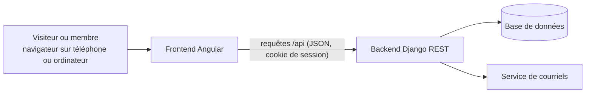
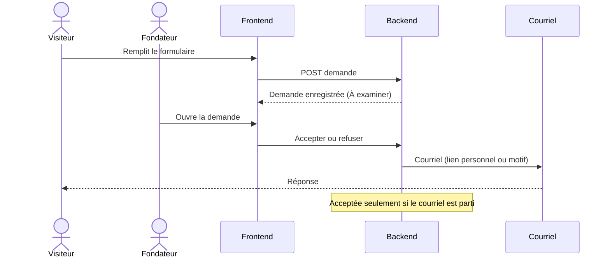

# Architecture technique

Vue d'ensemble de la plateforme. Document vivant, mis à jour avec le code.

## Vue d'ensemble



## Composants

| Composant | Dossier | Rôle |
|---|---|---|
| Frontend | `frontend/` | Application Angular : pages publiques, interface membre, interface bureau exécutif |
| Backend | `backend/` | API Django REST : comptes, territoires, demandes, membres, programmes |
| Base de données | SQLite en local, à choisir en production | Stockage des données |
| Courriels | Service d'envoi configurable | Réponses aux demandes, liens personnels, réinitialisation de mot de passe |

## Backend

- **Django 6** et **Django REST Framework**.
- Compte unique `accounts.User` : connexion par courriel, rôle `membre`, `coordonnateur` ou `fondateur`. Le bureau exécutif réunit coordonnateurs et fondateurs.
- Droits : vérifiés par le serveur à chaque requête, selon le rôle et le territoire.
- Configuration sensible lue dans l'environnement. En local, `backend/.env` (copie de `backend/.env.example`, jamais versionnée) est chargé au démarrage ; une variable déjà définie dans l'environnement est prioritaire.

### Applications Django

```
backend/
  config/        réglages, routes, lecture du fichier .env
  core/          socle commun : point de contrôle /api/health/
  accounts/      comptes et rôles
  territories/   territoires emboîtés pays, région, commune
  applications/  demandes d'adhésion et leur examen
  members/       membres, numéros, statuts, cartes
```

L'application `programs` (programmes, activités, présences) sera ajoutée avec ses fonctionnalités.

Chaque application regroupe ses modèles, son administration, ses routes (`urls.py`), ses vues et ses tests (`tests.py`).

### Territoires

Modèle `territories.Territory` : nom, type (`pays`, `region`, `commune`), territoire parent, actif ou non.

- Une commune est rattachée à une région, une région à un pays, un pays à rien. Vérifié à chaque enregistrement et par une contrainte en base.
- Un nom est unique parmi les territoires d'un même parent (une commune peut porter le nom de sa région).
- Un territoire utilisé ne peut pas être supprimé (protection en base) : on le désactive.
- Territoires de départ chargés par la migration `0002` : le Sénégal, ses 14 régions et 47 communes (chefs-lieux des 46 départements, plus Touba), à compléter par les fondateurs depuis l'administration.

### Demandes d'adhésion

Modèle `applications.Application` : référence, prénom, nom, courriel, localité souhaitée (territoire), profession, motivation, date du consentement, statut, dates de dépôt et de modification.

- Statuts : `a_examiner` (À examiner), `acceptee` (Acceptée), `rejetee` (Rejetée), `inscrite` (Inscrite). Une demande est « en cours » tant qu'elle est à examiner ou acceptée.
- Un même courriel (sans tenir compte des majuscules) ne peut avoir qu'une demande en cours : vérifié par l'API et par une contrainte en base. Un courriel déjà utilisé par un compte est refusé.
- Référence `TAB-AAAA-NNNNN` : année de dépôt et numéro unique de la demande (exemple : `TAB-2026-00418`). Le numéro ne repart pas de zéro chaque année.
- La localité est un territoire actif (commune ou région) dont les parents sont actifs.
- Le consentement au traitement des données est obligatoire ; sa date est conservée.
- Dépôt public limité à 10 envois par heure depuis une même adresse (variable `ADHESION_RATE`).
- Dans l'administration Django, les demandes sont en lecture seule : les décisions passent par l'API d'examen, qui envoie les courriels.

### Conventions de l'API

- Toutes les routes commencent par `/api/` et se terminent par une barre oblique (`/api/health/`).
- Échanges en JSON uniquement. L'interface navigable de Django REST Framework n'est active qu'en développement (`DJANGO_DEBUG=1`).
- Par défaut, une route exige une connexion ; les routes publiques le déclarent explicitement.
- Messages d'erreur en français. Une erreur générale a la forme `{"detail": "…", "code": "…"}` ; une erreur de saisie liste les messages par champ (`{"email": ["Ce champ est obligatoire."]}`).
- `401` : personne n'est connecté (le frontend renvoie vers la connexion). `403` : la personne connectée n'a pas le droit.

### Connexion et sécurité des requêtes

- Session Django par cookie, sur le même domaine que le frontend (le proxy Angular renvoie `/api` vers Django en développement).
- Courriel reconnu sans tenir compte des majuscules ; un courriel ne sert qu'à un seul compte (contrainte en base).
- Un compte désactivé (suspendu ou radié) ne peut plus se connecter, et sa session en cours cesse aussitôt d'être valable.
- Sans « rester connecté », la session se ferme avec le navigateur.
- Protection CSRF aux noms attendus par Angular : Django dépose le cookie `XSRF-TOKEN` (à la connexion et sur `GET /api/auth/me/`), et chaque requête qui modifie renvoie sa valeur dans l'en-tête `X-XSRF-TOKEN`. Le client HTTP d'Angular le fait tout seul.

### Routes

| Méthode et route | Accès | Rôle |
|---|---|---|
| `GET /api/health/` | public | Contrôle de santé : `{"status": "ready"}` (200), ou `{"status": "unavailable"}` (503) si la base est injoignable |
| `POST /api/auth/login/` | public | Connexion. Corps : `email`, `password`, `remember` (facultatif). Renvoie l'utilisateur (200) ; 400 `invalid_credentials` ; 403 `inactive_account` |
| `POST /api/auth/logout/` | public | Déconnexion (204) |
| `GET /api/auth/me/` | connecté | Utilisateur connecté : `id`, `email`, `first_name`, `last_name`, `role`, `role_label`, `is_bureau` ; 401 sinon |
| `GET /api/territories/` | public | Territoires actifs en arbre pays > région > commune, par ordre alphabétique : `[{"id", "name", "kind", "kind_label", "children": [...]}]`. Un territoire dont un parent est inactif n'apparaît pas |
| `POST /api/applications/` | public | Dépôt d'une demande. Corps : `first_name`, `last_name`, `email`, `territory` (identifiant), `profession`, `motivation`, `consent` (`true`). Renvoie `reference`, `status`, `status_label`, `created_at` (201) ; 400 avec un message par champ ; 429 si trop d'envois |

## Frontend

- **Angular** (composants autonomes), appels à l'API sous `/api` (redirigés vers le backend en développement par `proxy.conf.json`).
- Interface mobile d'abord, en français.
- Deux espaces : membre et bureau exécutif, ouverts selon le rôle renvoyé après la connexion.

## Flux principal : demande d'adhésion



## Sécurité

- Mot de passe d'au moins 10 caractères, stocké sous forme d'empreinte.
- Liens personnels : jeton aléatoire, empreinte seule conservée, valable 7 jours, usage unique.
- Connexion chiffrée (https) en production.
- Journal des actions importantes.
- Aucune donnée de membre ni secret dans le dépôt.

## Décisions à prendre

- Hébergement et base de données de production : voir la tâche de comparaison du Sprint 0.
- Service d'envoi de courriels en production.
- Stockage des photos (dans la base ou à part).

## Décisions prises

| Date | Décision | Raison |
|---|---|---|
| 2026-10-15 | Django + Angular | Choix du propriétaire du projet |
| 2026-10-15 | Pas d'intégration ni de déploiement automatiques | Choix du propriétaire du projet |
