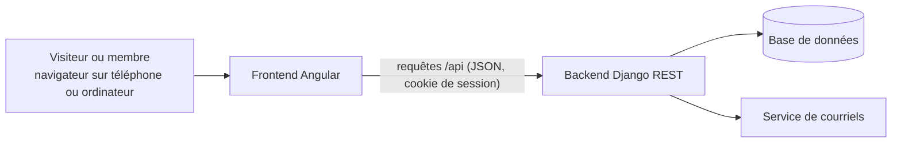
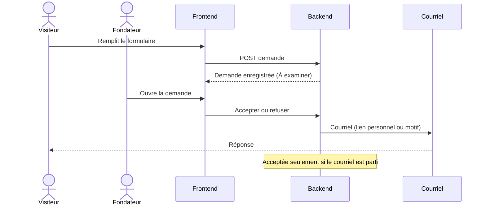

# Architecture technique

Vue d'ensemble de la plateforme. Document vivant, mis à jour avec le code.

## Vue d'ensemble



## Composants

| Composant | Dossier | Rôle |
|---|---|---|
| Frontend | `frontend/` | Application Angular : pages publiques, interface membre, interface bureau exécutif |
| Backend | `backend/` | API Django REST : comptes, territoires, demandes, membres, programmes |
| Base de données | SQLite en local, à choisir en production | Stockage des données |
| Courriels | Service d'envoi configurable | Réponses aux demandes, liens personnels, réinitialisation de mot de passe |

## Backend

- **Django 6** et **Django REST Framework**.
- Compte unique `accounts.User` : connexion par courriel, rôle `membre`, `coordonnateur` ou `fondateur`. Le bureau exécutif réunit coordonnateurs et fondateurs.
- Droits : vérifiés par le serveur à chaque requête, selon le rôle et le territoire.
- Configuration sensible lue dans l'environnement. En local, `backend/.env` (copie de `backend/.env.example`, jamais versionnée) est chargé au démarrage ; une variable déjà définie dans l'environnement est prioritaire.

### Applications Django

```
backend/
  config/        réglages, routes, lecture du fichier .env
  core/          socle commun : point de contrôle /api/health/
  accounts/      comptes et rôles
  territories/   territoires emboîtés pays, région, commune
  applications/  demandes d'adhésion et leur examen
  members/       membres, numéros, statuts, cartes
```

L'application `programs` (programmes, activités, présences) sera ajoutée avec ses fonctionnalités.

Chaque application regroupe ses modèles, son administration, ses routes (`urls.py`), ses vues et ses tests (`tests.py`).

### Territoires

Modèle `territories.Territory` : nom, type (`pays`, `region`, `commune`), territoire parent, actif ou non.

- Une commune est rattachée à une région, une région à un pays, un pays à rien. Vérifié à chaque enregistrement et par une contrainte en base.
- Un nom est unique parmi les territoires d'un même parent (une commune peut porter le nom de sa région).
- Un territoire utilisé ne peut pas être supprimé (protection en base) : on le désactive.
- Chaque compte peut être rattaché à un territoire (`User.territory`) : territoire du membre, ou territoire de coordination du coordonnateur (obligatoire pour lui). Un fondateur n'en a pas besoin.
- Règle d'accès réutilisable (`territories/scope.py`) : un fondateur voit tout ; un coordonnateur voit son territoire et tous ceux qui en dépendent ; un membre simple ne voit rien au bureau. Toute liste du bureau passe par `scope_queryset(...)`. Un objet hors du périmètre répond 404, pas 403, pour ne pas révéler son existence.
- Territoires de départ chargés par la migration `0002` : le Sénégal, ses 14 régions et 47 communes (chefs-lieux des 46 départements, plus Touba), à compléter par les fondateurs depuis l'administration.

### Demandes d'adhésion

Modèle `applications.Application` : référence, prénom, nom, courriel, localité souhaitée (territoire), profession, motivation, date du consentement, statut, dates de dépôt et de modification.

- Statuts : `a_examiner` (À examiner), `acceptee` (Acceptée), `rejetee` (Rejetée), `inscrite` (Inscrite). Une demande est « en cours » tant qu'elle est à examiner ou acceptée.
- Un même courriel (sans tenir compte des majuscules) ne peut avoir qu'une demande en cours : vérifié par l'API et par une contrainte en base. Un courriel déjà utilisé par un compte est refusé.
- Référence `TAB-AAAA-NNNNN` : année de dépôt et numéro unique de la demande (exemple : `TAB-2026-00418`). Le numéro ne repart pas de zéro chaque année.
- La localité est un territoire actif (commune ou région) dont les parents sont actifs.
- Le consentement au traitement des données est obligatoire ; sa date est conservée.
- Dépôt public limité à 10 envois par heure depuis une même adresse (variable `ADHESION_RATE`).
- Dans l'administration Django, les demandes sont en lecture seule : les décisions passent par l'API d'examen, qui envoie les courriels.
- Examen réservé aux fondateurs (`accounts.permissions.IsFounder`). Seule une demande « À examiner » peut être acceptée ou refusée ; chaque décision enregistre son auteur, sa date et une note interne facultative.
- Un refus exige un motif écrit, envoyé par courriel à la personne. Toute décision n'est enregistrée que si son courriel est parti : sinon la demande reste « À examiner » et le fondateur voit l'erreur (`503 email_not_sent`). Logique dans `applications/services.py`.
- L'acceptation crée un lien personnel (`RegistrationLink`) et l'envoie par courriel : `FRONTEND_URL/finaliser?jeton=…`. Le jeton (256 bits aléatoires) n'est jamais conservé, seule son empreinte SHA-256 l'est (`core/tokens.py`). Le lien est valable 7 jours et ne sert qu'une fois (consommation atomique). Si le courriel ne part pas, le lien n'existe pas et la demande reste « À examiner ».

### Membres

Modèle `members.Member`, relié à un compte (un dossier par compte) : numéro de membre, date d'adhésion.

- Numéro `TBX-AAAA-NNNNN` attribué automatiquement à la création : année d'adhésion et numéro d'ordre unique, jamais réutilisé (exemple : `TBX-2026-00125`). Unicité garantie en base.
- Adresse et téléphone (facultatif) chiffrés en base ; photo, date d'acceptation des statuts et du règlement, demande d'origine.
- Finalisation (`members/registration.py`) : le lien personnel reçu à l'acceptation permet de choisir son mot de passe (règles de sécurité de Django : 10 caractères au moins, pas seulement des chiffres, pas un mot de passe courant, pas semblable au nom ou au courriel), de donner son adresse et sa photo. Le compte membre (actif, rattaché au territoire de la demande) et son dossier sont créés, le lien est consommé et la demande passe « Inscrite », en une seule transaction ; la session s'ouvre. Lien inconnu : 404 `invalid_link` ; expiré : 410 `link_expired` ; déjà utilisé : 410 `link_used`, chacun avec un message qui dit quoi faire.
- Photos : vérifiées (vraie image JPG ou PNG, 5 Mo au plus), réenregistrées en JPEG de 800 pixels au plus, sans aucune métadonnée (position GPS comprise), sous un nom aléatoire dans `MEDIA_ROOT/photos/`. Jamais servies directement : seulement par l'API, à la personne concernée.

### Courriels

- Service unique `core.mail.send_email(to=…, subject=…, body=…)` : il lève `EmailNotSent` si le courriel ne part pas (serveur injoignable, refus, envoi non confirmé). L'échec est écrit dans le journal du serveur, sans l'adresse du destinataire.
- Configuration par variables d'environnement (`backend/.env.example`) : sans `EMAIL_HOST`, les courriels s'affichent dans la console du serveur ; avec `EMAIL_HOST`, ils partent par SMTP (`EMAIL_PORT`, `EMAIL_HOST_USER`, `EMAIL_HOST_PASSWORD`, `EMAIL_USE_TLS` ou `EMAIL_USE_SSL`, `EMAIL_TIMEOUT`). Expéditeur : `DEFAULT_FROM_EMAIL`.
- Aucun identifiant dans le code : ils ne vivent que dans l'environnement ou dans `backend/.env`, ignoré par Git.

### Conventions de l'API

- Toutes les routes commencent par `/api/` et se terminent par une barre oblique (`/api/health/`).
- Échanges en JSON uniquement. L'interface navigable de Django REST Framework n'est active qu'en développement (`DJANGO_DEBUG=1`).
- Par défaut, une route exige une connexion ; les routes publiques le déclarent explicitement.
- Messages d'erreur en français. Une erreur générale a toujours la forme `{"detail": "…", "code": "…"}` (`not_authenticated`, `permission_denied`, `not_found`, `session_expired`…, voir `core/exceptions.py`) ; une erreur de saisie liste les messages par champ (`{"email": ["Ce champ est obligatoire."]}`).
- `401` : personne n'est connecté (le frontend renvoie vers la connexion). `403` : la personne connectée n'a pas le droit.

### Connexion et sécurité des requêtes

- Session Django par cookie, sur le même domaine que le frontend (le proxy Angular renvoie `/api` vers Django en développement).
- Courriel reconnu sans tenir compte des majuscules ; un courriel ne sert qu'à un seul compte (contrainte en base).
- Un compte désactivé (suspendu ou radié) ne peut plus se connecter, et sa session en cours cesse aussitôt d'être valable.
- Sans « rester connecté », la session se ferme avec le navigateur.
- La session d'un coordonnateur ou d'un fondateur se ferme après 30 minutes sans requête (`accounts.middleware.BureauInactivityMiddleware`, réglable par `BUREAU_INACTIVITY_MINUTES`) ; la requête suivante reçoit `401 session_expired`. Les membres simples ne sont pas concernés.
- Blocage temporaire (`accounts/lockout.py`) : après 5 échecs pour un même courriel, ou 20 depuis une même adresse IP, la connexion est refusée pendant 15 minutes (`429 too_many_attempts`, en-tête `Retry-After`), même avec le bon mot de passe. Une connexion réussie efface les échecs du compte ; les échecs sont effacés après un jour. Derrière un proxy en production, régler `LOGIN_TRUSTED_PROXIES` pour lire la vraie adresse du visiteur.
- Mot de passe oublié (`accounts/password_reset.py`) : lien par courriel vers `FRONTEND_URL/nouveau-mot-de-passe?jeton=…`, valable **une heure**, utilisable une fois ; un nouveau lien annule le précédent ; trois demandes par heure au plus par compte. La réponse est la même qu'un compte existe ou non. Le nouveau mot de passe ferme les autres sessions et lève le blocage de connexion.
- Invitation au bureau (`accounts/invitations.py`) : un fondateur saisit courriel, nom, fonction (coordonnateur ou fondateur) et territoire (obligatoire pour un coordonnateur). Le compte est créé sans mot de passe utilisable et un lien (7 jours, une fois) part vers `FRONTEND_URL/invitation?jeton=…` ; si le courriel ne part pas, rien n'est créé. En acceptant, la personne choisit son mot de passe, reçoit son dossier et son numéro, et sa session s'ouvre sur l'interface du bureau. Un fondateur invité a aussi accès à l'administration Django.
- Liens personnels : base commune `core.models.OneTimeLink` (inscription, réinitialisation, invitation).
- Protection CSRF aux noms attendus par Angular : Django dépose le cookie `XSRF-TOKEN` (à la connexion et sur `GET /api/auth/me/`), et chaque requête qui modifie renvoie sa valeur dans l'en-tête `X-XSRF-TOKEN`. Le client HTTP d'Angular le fait tout seul.

### Routes

| Méthode et route | Accès | Rôle |
|---|---|---|
| `GET /api/health/` | public | Contrôle de santé : `{"status": "ready"}` (200), ou `{"status": "unavailable"}` (503) si la base est injoignable |
| `POST /api/auth/login/` | public | Connexion. Corps : `email`, `password`, `remember` (facultatif). Renvoie l'utilisateur (200) ; 400 `invalid_credentials` ; 403 `inactive_account` ; 429 `too_many_attempts` |
| `POST /api/auth/logout/` | public | Déconnexion (204) |
| `GET /api/auth/me/` | connecté | Utilisateur connecté : `id`, `email`, `first_name`, `last_name`, `role`, `role_label`, `is_bureau`, `territory` ; 401 sinon |
| `POST /api/auth/password/forgot/` | public | Demande un lien de réinitialisation. Corps : `email`. Toujours 200 avec le même message |
| `POST /api/auth/password/reset/check/` | public | Vérifie un lien de réinitialisation. Corps : `token`. Renvoie `email`, `expires_at` ; 404 `invalid_link`, 410 `link_expired` ou `link_used` |
| `POST /api/auth/password/reset/` | public | Nouveau mot de passe. Corps : `token`, `password`, `password_confirm`. 200 ; 400 avec un message par champ ; 404 ou 410 si le lien ne sert plus |
| `POST /api/auth/password/change/` | connecté | Changement du mot de passe. Corps : `current_password`, `new_password`, `new_password_confirm`. La session reste ouverte, les autres sont fermées |
| `POST /api/auth/invitations/` | fondateur | Invite au bureau. Corps : `email`, `first_name`, `last_name`, `role` (`coordonnateur` ou `fondateur`), `territory`. 201 ; 400 avec un message par champ ; 503 `email_not_sent` (aucun compte créé) |
| `POST /api/auth/invitation/check/` | public | Vérifie un lien d'invitation. Corps : `token`. Renvoie `email`, `first_name`, `last_name`, `role`, `role_label`, `territory`, `expires_at` |
| `POST /api/auth/invitation/accept/` | public | Accepte l'invitation. Corps : `token`, `password`, `password_confirm`. Renvoie l'utilisateur (201) et ouvre la session |
| `GET /api/territories/` | public | Territoires actifs en arbre pays > région > commune, par ordre alphabétique : `[{"id", "name", "kind", "kind_label", "children": [...]}]`. Un territoire dont un parent est inactif n'apparaît pas |
| `GET /api/territories/managed/` | bureau | Territoires du périmètre de la personne connectée, actifs ou non, en ordre d'arbre : `id`, `name`, `kind`, `kind_label`, `path`, `parent`, `is_active` |
| `GET /api/territories/managed/<id>/` | bureau | Un territoire du périmètre ; 404 s'il est hors périmètre |
| `POST /api/applications/` | public | Dépôt d'une demande. Corps : `first_name`, `last_name`, `email`, `territory` (identifiant), `profession`, `motivation`, `consent` (`true`). Renvoie `reference`, `status`, `status_label`, `created_at` (201) ; 400 avec un message par champ ; 429 si trop d'envois |
| `GET /api/applications/` | fondateur | Demandes, les plus récentes d'abord, par pages de 20 (`count`, `next`, `previous`, `results`). Filtres : `status`, `search` (nom, prénom, courriel, référence), `page`, `page_size` |
| `GET /api/applications/<id>/` | fondateur | Demande complète : identité, localité (`territory.path`), motivation, statut, décision (`decided_by`, `decided_at`, `rejection_reason`, `internal_note`) |
| `POST /api/applications/<id>/accept/` | fondateur | Acceptation. Corps : `internal_note` (facultatif). Envoie le lien personnel d'inscription. 409 `already_decided` ; 503 `email_not_sent` (la demande reste « À examiner ») |
| `POST /api/registration/check/` | public | Vérifie un lien personnel. Corps : `token`. Renvoie `first_name`, `last_name`, `email`, `territory`, `expires_at` ; 404 `invalid_link`, 410 `link_expired` ou `link_used` |
| `POST /api/registration/` | public | Finalise l'inscription (formulaire multipart). Champs : `token`, `address`, `phone` (facultatif), `photo`, `password`, `password_confirm`, `accept_rules`. Renvoie `user` et `member_number` (201) et ouvre la session ; 400 avec un message par champ ; 409 `account_exists` |
| `GET /api/members/me/` | connecté | Profil et données de carte : `number`, `joined_on`, `first_name`, `last_name`, `email`, `role`, `role_label`, `territory`, `address`, `phone`, `photo_url` ; 404 sans dossier de membre |
| `PATCH /api/members/me/` | connecté | Modifie `address`, `phone`, `photo` (multipart pour la photo). Nom, courriel, territoire, numéro et date d'adhésion : 400 « Seul le bureau peut modifier cette information. » |
| `GET /api/members/me/photo/` | connecté | Photo de profil de la personne connectée (JPEG) ; 404 sans photo |
| `POST /api/applications/<id>/reject/` | fondateur | Refus. Corps : `reason` (obligatoire), `internal_note`. Envoie le motif par courriel. 409 `already_decided` ; 503 `email_not_sent` |

## Frontend

- **Angular** (composants autonomes), appels à l'API sous `/api` (redirigés vers le backend en développement par `proxy.conf.json`).
- Interface mobile d'abord, en français.
- Deux espaces : membre et bureau exécutif, ouverts selon le rôle renvoyé après la connexion.

## Flux principal : demande d'adhésion



## Sécurité

- Mot de passe d'au moins 10 caractères, stocké sous forme d'empreinte Argon2id ; les anciennes empreintes PBKDF2 sont converties à la connexion suivante.
- Sans `DJANGO_DEBUG=1`, le serveur se comporte comme en production : il refuse de démarrer sans vraie clé secrète (50 caractères au moins), redirige tout vers https, active HSTS (un an) et n'envoie les cookies qu'en https. Derrière un hébergeur qui termine le https, `DJANGO_BEHIND_HTTPS_PROXY=1`. Contrôle : `python manage.py check --deploy`.
- En-têtes sur toutes les réponses de Django : politique de contenu (CSP) stricte, `X-Frame-Options: DENY`, `X-Content-Type-Options: nosniff`, `Referrer-Policy: same-origin`, `Cross-Origin-Opener-Policy: same-origin`. Le frontend, servi à part, devra avoir les mêmes en-têtes chez son hébergeur.
- Cookie de session `HttpOnly` (illisible par le JavaScript) et `SameSite=Lax` ; le cookie anti-CSRF reste lisible, car Angular doit le renvoyer.
- Liens personnels : jeton aléatoire, empreinte seule conservée, valable 7 jours, usage unique.
- Données sensibles chiffrées en base (`core.fields.EncryptedTextField`, Fernet : AES avec contrôle d'intégrité HMAC-SHA256) : motivation, motif de refus et note interne des demandes ; adresse et téléphone des membres dès qu'ils existeront. Une copie de la base ne suffit pas à les lire. On ne peut ni chercher ni trier sur ces champs.
- Clés dans `FIELD_ENCRYPTION_KEYS` (obligatoire en production, jamais versionnée) : la première chiffre, toutes déchiffrent. Changement de clé : `NOUVELLE,ANCIENNE`, puis `python manage.py rechiffrer`, puis retrait de l'ancienne. **Perdre la clé, c'est perdre ces données** : elle doit être sauvegardée à part, hors du serveur et hors de la sauvegarde de la base.
- Journal des actions importantes (à venir, #42).
- Aucune donnée de membre ni secret dans le dépôt.

## Décisions à prendre

- Hébergement et base de données de production : voir la tâche de comparaison du Sprint 0.
- Service d'envoi de courriels en production.
- Stockage des photos (dans la base ou à part).

## Décisions prises

| Date | Décision | Raison |
|---|---|---|
| 2026-10-15 | Django + Angular | Choix du propriétaire du projet |
| 2026-10-15 | Pas d'intégration ni de déploiement automatiques | Choix du propriétaire du projet |
