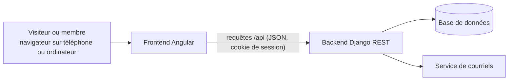
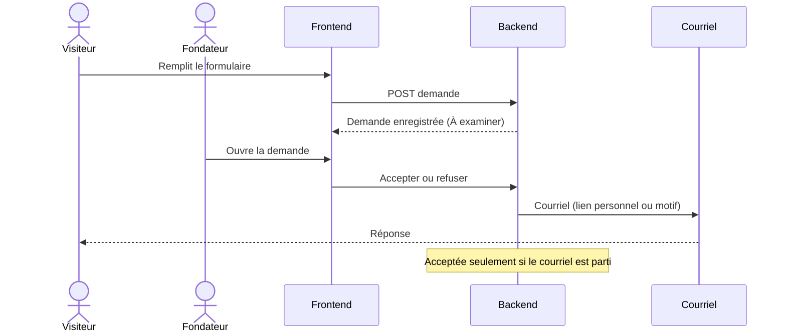

# Architecture technique

Vue d'ensemble de la plateforme. Document vivant, mis à jour avec le code.

## Vue d'ensemble

## Composants

| Composant | Dossier | Rôle |
|---|---|---|
| Frontend | `frontend/` | Application Angular : pages publiques, interface membre, interface bureau exécutif |
| Backend | `backend/` | API Django REST : comptes, territoires, demandes, membres, programmes |
| Base de données | SQLite en local, à choisir en production | Stockage des données |
| Courriels | Service d'envoi configurable | Réponses aux demandes, liens personnels, réinitialisation de mot de passe |

## Backend

- **Django 6** et **Django REST Framework**.
- Compte unique `accounts.User` : connexion par courriel, rôle `membre`, `coordonnateur` ou `fondateur`. Le bureau exécutif réunit coordonnateurs et fondateurs.
- Applications prévues :
  - `accounts` : comptes et rôles (existe) ;
  - `territories` : territoires emboîtés pays, région, commune ;
  - `applications` : demandes d'adhésion et leur examen ;
  - `members` : membres, cartes, statuts ;
  - `programs` : programmes, activités, présences.
- Droits : vérifiés par le serveur à chaque requête, selon le rôle et le territoire.
- Configuration sensible lue dans l'environnement (`backend/.env.example`).

## Frontend

- **Angular** (composants autonomes), appels à l'API sous `/api` (redirigés vers le backend en développement par `proxy.conf.json`).
- Interface mobile d'abord, en français.
- Deux espaces : membre et bureau exécutif, ouverts selon le rôle renvoyé après la connexion.

## Flux principal : demande d'adhésion

## Sécurité

- Mot de passe d'au moins 10 caractères, stocké sous forme d'empreinte.
- Liens personnels : jeton aléatoire, empreinte seule conservée, valable 7 jours, usage unique.
- Connexion chiffrée (https) en production.
- Journal des actions importantes.
- Aucune donnée de membre ni secret dans le dépôt.

## Décisions à prendre

- Hébergement et base de données de production : voir la tâche de comparaison du Sprint 0.
- Service d'envoi de courriels en production.
- Stockage des photos (dans la base ou à part).

## Décisions prises

| Date | Décision | Raison |
|---|---|---|
| 2026-10-15 | Django + Angular | Choix du propriétaire du projet |
| 2026-10-15 | Pas d'intégration ni de déploiement automatiques | Choix du propriétaire du projet |
